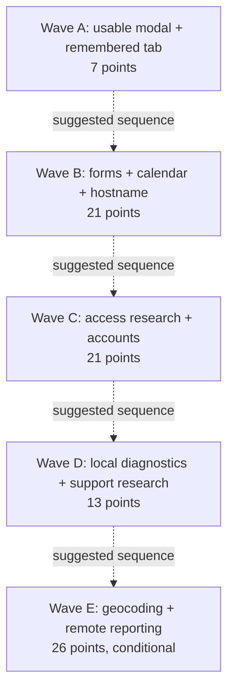

# CrewBoard PBI assessment and suggested roadmap

Assessment date: November 3, 2026.

## Executive recommendation

Start by making the employee editor reliably usable, then deliver the small
navigation improvement. Establish consistent form controls before adding more
forms, and improve the calendar workflow next.

For the larger items, validate account and access-model decisions before
implementation. Research geocoding before committing to a provider. Split local
diagnostics from remote reporting so supportability does not require operating
an online service.

**Best quick win:** remember the active tab.  
**Most important usability fix:** the accessible, scrollable employee modal.  
**Largest operational opportunity:** reliable individual accounts and eventual
delegation without sharing the owner login.  
**Most scope-sensitive item:** the error console with remote reporting.

## How to read the estimates

These are planning judgments based on the ten PBI specifications, not measured
delivery times or an audit confirming which acceptance criteria are already met.
All ten source PBIs said **Proposed** at assessment time. The completion checklist
and linked PBIs track subsequent implementation and acceptance. Re-estimate before
starting work.

| Measure | Scale | Meaning |
| --- | --- | --- |
| Effort | 1, 2, 3, 5, 8, 13, 21 story points | Relative implementation or research effort, uncertainty, regression coverage, documentation, and acceptance testing. Points are not hours or days. |
| Difficulty | Low / Medium / High / Very high | Technical and validation complexity, not simply the number of files changed. |
| Importance | Critical / High / Medium / Low | Urgency and consequences of deferral for the current small-team, local-first product. |
| Value | 1–10 value points | Expected benefit to users or maintainers: 1 is minor polish, 5 is useful, 8 is a substantial workflow improvement, 10 is foundational. Higher is better. |
| Confidence | High / Medium / Low | Confidence in the effort estimate given the decisions and external dependencies still open. |

Effort and value use **different scales**. A high effort estimate is a cost, not
a benefit. Value points are subjective comparison scores, not revenue forecasts
or additive measures of customer benefit.

Assumptions:

- The existing Bootstrap/jQuery interface and Arduino architecture remain.
- API and permission changes must work on both the CYD and local development
  server; static interface changes use the shared deployable web assets.
- CYD builds and real-device testing remain necessary for firmware changes.
- Mobile, keyboard, accessibility, migration, and failure-path tests count toward
  effort where the PBI requires them.
- Research points cover the specified investigation and deliverables, **not**
  subsequent production implementation.
- No estimate assumes an unselected hosted service, secret-bearing browser
  integration, new authentication architecture, or new framework.

## Completion checklist

Change `[ ]` to `[x]` when the linked PBI's acceptance criteria and definition of
done have been verified. All items start unchecked; these estimates do not
establish completion. For research spikes, completion means the research
deliverables and decision are finished, not that the resulting feature is built.
Update the source PBI's status when marking it complete.

- [x] 1. [Accessible, scrollable employee modal](PBI-accessible-employee-modal.md) — implemented; manual device/accessibility acceptance pending
- [ ] 2. [Remember the active tab](PBI-remember-active-tab.md)
- [ ] 3. [Semantic, data-specific form controls](PBI-semantic-form-controls.md)
- [ ] 4. [Calendar-first schedule and date drill-down](PBI-calendar-first-schedule.md)
- [ ] 5. [Memorable local hostname](PBI-local-hostname.md)
- [ ] 6. [Research role-based abilities](PBI-research-role-based-abilities.md) — research only
- [ ] 7. [Mandatory usernames and password changes](PBI-mandatory-usernames-and-password-changes.md)
- [ ] 8. [Address geocoding](PBI-address-geocoding.md)
- [ ] 9. [Exportable JSON error console](PBI-json-error-console.md)
- [ ] 10. [Research customer-support intake](PBI-research-customer-support-intake.md) — research only

For item 9, local-only delivery does not complete the current full specification.
If the proposed split is approved, track the two resulting PBIs separately.

## PBI comparison

The order below is a recommended starting sequence, not a strict dependency chain.

| Order | PBI | Kind | Difficulty | Effort | Importance | Value / 10 | Confidence |
| --- | --- | --- | --- | ---: | --- | ---: | --- |
| 1 | [Accessible, scrollable employee modal](PBI-accessible-employee-modal.md) | Delivery | Medium | 5 | Critical | 9 | Medium |
| 2 | [Remember the active tab](PBI-remember-active-tab.md) | Delivery | Low | 2 | Medium | 6 | High |
| 3 | [Semantic, data-specific form controls](PBI-semantic-form-controls.md) | Delivery | Medium | 8 | High | 8 | Medium |
| 4 | [Calendar-first schedule and date drill-down](PBI-calendar-first-schedule.md) | Delivery | Medium | 8 | High | 8 | Medium |
| 5 | [Memorable local hostname](PBI-local-hostname.md) | Delivery | Medium | 5 | High | 8 | Medium |
| 6 | [Research role-based abilities](PBI-research-role-based-abilities.md) | Research spike | High | 8 | High | 8 | Medium |
| 7 | [Mandatory usernames and password changes](PBI-mandatory-usernames-and-password-changes.md) | Delivery | High | 13 | High | 9 | Low |
| 8 | [Address geocoding](PBI-address-geocoding.md) | Delivery, including provider investigation | High | 13 | Medium | 8 | Low |
| 9 | [Exportable JSON error console](PBI-json-error-console.md) | Delivery, including optional remote-reporting capability | Very high | 21 | Medium | 8 | Low |
| 10 | [Research customer-support intake](PBI-research-customer-support-intake.md) | Research spike | Medium | 5 | Medium | 6 | Medium |

**Baseline scope: 88 effort points across the ten specifications:** 75 delivery
points and 13 research points. This is a rough backlog size, not a release
commitment. Shared work may overlap, and research may change later estimates.
Production role-based authorization and a production support form are not
included in that total because their PBIs are research-only.

## Rationale and scope risks

### 1. Accessible employee modal — 5 effort / 9 value

The PBI reports that a core onboarding form can place fields and Save/Cancel
outside the reachable viewport. That makes this more urgent than cosmetic work.
The likely markup/flex-layout fix is small; the meaningful effort is testing
focus, screen-reader behavior, zoom, virtual keyboards, and every editor sharing
the modal.

**Why first:** restoring reachability improves a workflow that already exists.
Confirm the reported failure on representative devices before implementing.
Do not treat one desktop scrollbar check as completion.

### 2. Remember the active tab — 2 effort / 6 value

A narrow, browser-only change with no API, data migration, or CYD resource cost.
It removes repeated navigation for frequent users.

**Main risks:** blocked or invalid storage, Bootstrap accessibility state, and
restoring Locations before its map can render correctly. Preferences are
origin-specific; an IP address and hostname do not share the same preference.

### 3. Semantic form controls — 8 effort / 8 value

This improves mobile entry, validation, autofill behavior, and accessibility
throughout the product. Several controls are already correct, so the value comes
from fixing gaps and establishing a consistent pattern, not replacing everything.

**Main risks:** birthday formats with an optional year, employee forms receiving
the owner's autofill values, and silently changing existing stored values.
Resolve the birthday decision explicitly. Apply the pattern to forms that exist
at delivery, then require later PBIs to follow it rather than waiting for every
future form.

### 4. Calendar-first schedule — 8 effort / 8 value

A meaningful improvement to the application's central daily workflow. This is
more than changing a default: the PBI changes List from all jobs to a selected
day and requires consistent selection, month navigation, focus, and Add Job
defaults.

**Main risks:** accidentally removing useful visibility of upcoming work, stale
date filters after edits, local-date shifts, and leap/year boundaries. Confirm
that a separately labeled all-jobs view is not required for the initial scope.

### 5. Local hostname — 5 effort / 8 value

A memorable address reduces device-access and onboarding friction without
changing the business workflows.

**Main risks:** actual router/client behavior, NetBIOS availability in the chosen
ESP32 core, mDNS failures, and setup-access-point behavior. Hardware and network
testing dominate the uncertainty. A plain hostname is not guaranteed DNS.

### 6. Role-based abilities research — 8 effort / 8 value

The value is reducing architectural uncertainty before delegation is built. The
specified route inventory, permission matrix, migration plan, owner-lockout
rules, resource assessment, and scoped follow-on PBIs make this a substantial
spike, not a short role-name discussion.

**Main risks:** confusing business titles with access, record-scoped crew-lead
permissions, account deactivation, and permission checks missed on WebDAV.
Use the spike to agree on account metadata before the password work lands, but
do not make production delegation a prerequisite for self-service passwords.

**Not included:** implementing the approved permission model.

### 7. Mandatory usernames and password changes — 13 effort / 9 value

Individual accounts, temporary-password handling, and self-service changes have
high operational value. However, mandatory usernames alone are not the whole
feature: enforcement must span roster/account updates, first-use restrictions,
legacy data, safe configuration writes, and immediate credential changes.

**Main risks:** cached HTTP Basic credentials across browsers, partial
roster/account saves, locking out the owner, and inconsistencies between the
local API and firmware. Prototype the sign-in-again flow early. If it requires
changing authentication architecture, stop and re-scope rather than hiding that
work inside 13 points.

This does not solve plaintext credentials at rest or HTTP transport exposure;
those remain explicitly outside this PBI.

### 8. Address geocoding — 13 effort / 8 value

Address-first entry removes a significant barrier to using the map. Browser-side
lookup can preserve lightweight firmware, but coverage, privacy, CORS, provider
policies, and deployment scale must be resolved first.

**Main risks:** residential-address disclosure, global rate limiting across
clients, ambiguous/stale results, provider availability, and secret-bearing
providers needing a proxy. The estimate assumes a suitable browser-accessible
provider; operating a new proxy or service requires re-estimation.

**Suggested split:** provider decision/proof of concept, 5 points; reviewed
lookup and manual-fallback workflow, 8 points. Do not select a provider solely
because a single request works.

### 9. JSON error console — 21 effort / 8 value

Local exportable diagnostics would make failures on customer phones much easier
to investigate. The full specification also includes remote delivery, bounded
offline queues, acknowledgment/deduplication, disabling, and verification of
receiving-service controls. That is materially larger than adding a download
button.

**Suggested split requiring PBI approval:**

- **Local console and JSON export: 8 points; value 8/10.** Deliver capture,
  redaction, bounded storage, review, clear, and download without a service.
- **Remote-reporting integration: 13 points; incremental value 5/10 at current
  assumed scale.** Reassess after an endpoint contract and operational owner
  exist. This is not a commitment to build a general hosted monitoring service.

**Main risks:** exception text or stack content leaking user data despite a
field allowlist, recursive logger failures, duplicate alerts, and retry queues
surviving disablement. Remote reporting is disabled by default, but its
capability and verification are still part of the current definition of done.
Shipping local-only therefore needs an explicit scope split.

### 10. Customer-support intake research — 5 effort / 6 value

Testing `mailto:` plus a copy fallback can avoid unnecessary service costs and
give the product a clearer support path. Value rises if external customer
onboarding or sales are imminent.

**Main risks:** no configured mail handler, URI length and encoding differences,
copy behavior on local HTTP, and obtaining the required Windows/Android/iPhone
test coverage. A desktop-only prototype does not complete this spike.

**Not included:** a production Support page, live diagnostic endpoints, or a
ticketing service. Do not make this spike depend on remote error reporting.

## Recommended delivery waves

These waves are planning suggestions, not sprint or calendar promises.

| Wave | Scope | Effort | Exit goal |
| --- | --- | ---: | --- |
| A — Reachability and quick win | Employee modal + remembered tab | 7 | Existing forms are reachable; repeat visits restore context. |
| B — Daily usability | Semantic controls + calendar-first schedule + local hostname | 21 | Easier field entry, daily planning, and network access. |
| C — Account foundations | Role/access research + username/password delivery | 21 | Approved access-model direction and reliable individual account lifecycle. |
| D — Supportability | Local JSON error console + support-intake research | 13 | Users can collect useful diagnostics and the support-channel decision is evidenced. |
| E — Conditional integrations | Geocoding + remote-reporting integration | 26 | Provider and endpoint decisions justify the added online dependencies. |

The waves total the same 88 points **only if** the proposed error-console split
is approved. Wave C research informs future authorization work; it does not
deliver delegated access. If account ownership is already blocking operations,
pull Wave C ahead of the hostname/calendar work. If customer sales are imminent,
pull support-intake research forward. If diagnostics are currently blocking
development, pull the local-only console into Wave B.

### Dependencies versus coordination

The wave arrows express sequencing preferences, **not technical prerequisites**.

- Role/access research needs product approval of its matrix **before production
  authorization implementation**, which is a future PBI.
- Geocoding needs an acceptable provider decision before production lookup
  integration.
- Remote error reporting needs an agreed endpoint, privacy disclosure, and
  operating responsibility; local logging/export should stand alone.
- The modal and semantic-control PBIs share layout/validation concerns and
  should coordinate, but neither must wait for future account or geocoding forms.
- Password and role research share account/migration decisions; they do not
  require implementing the entire delegation model together.
- Remembering the primary tab and changing Schedule's subview are compatible,
  independent features. Test them together when both are available.

## Decisions that would change the ranking

1. **Is onboarding currently blocked by the modal?** If confirmed, retain its
   Critical importance; otherwise it is still a High-priority accessibility fix.
2. **Does a real office administrator need delegation now?** If yes, prioritize
   role research and estimate its resulting implementation PBIs separately.
3. **Which phones, browsers, and mail handlers are supported?** A concrete test
   matrix materially improves estimates for forms, passwords, and support.
4. **Are residential addresses permitted to leave the local network?** This can
   change the viable geocoding architecture and cost.
5. **Who operates the reporting endpoint, and is one already available?** Without
   an answer, do not commit remote reporting to the first release.
6. **Are external customers imminent?** If so, support intake, local diagnostics,
   and memorable access move up relative to convenience work.

Use the scores to start prioritization, then revisit them after the first small
deliveries and each research decision. Do not optimize solely for low effort:
the account and accessibility work carry consequences that a points ratio alone
would miss.
